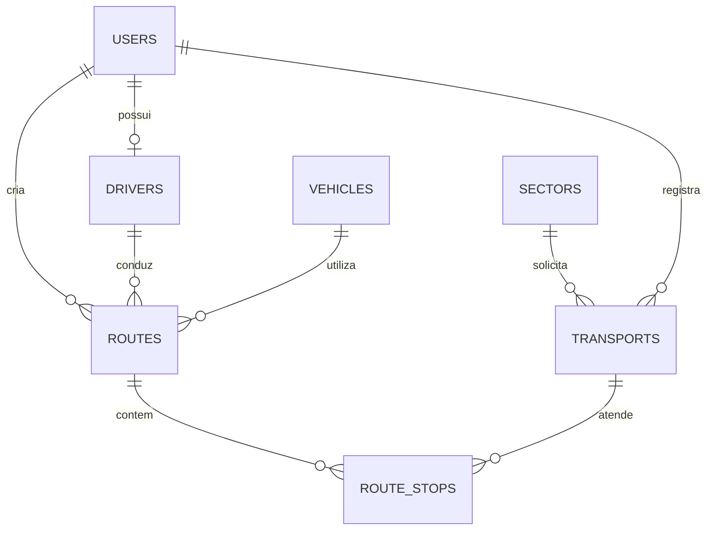
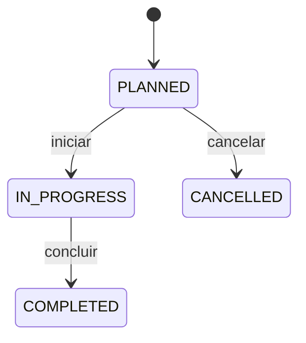

# Transportes, viagens e paradas

A API implementa o fluxo do diagrama
[Transport Management](https://mermaid.ai/view/74e0ce55-ef7a-4eda-aaa1-58e5fce666c7):
uma solicitação é registrada em `Transport`, a viagem é planejada em `Route` e
`RouteStop` organiza o atendimento das solicitações durante a viagem.

## 1. Entidades e relacionamentos



`Driver` e a tabela `drivers` existentes representam o conceito
`DRIVER_PROFILES` do diagrama. A chave `Route.driver_id` referencia `drivers.id`;
o identificador de autenticação corresponde a `users.id`.

Uma viagem pode atender vários transportes. Um transporte também pode aparecer
em várias paradas, inclusive de viagens diferentes, preservando as cardinalidades
do desenho. Cada parada referencia exatamente uma viagem e um transporte.

### Transport / transports

| Campo Java | Coluna | Comportamento |
| --- | --- | --- |
| `id` | `id` | UUID gerado na criação. |
| `sector` | `sector_id` | Setor do solicitante, fixado na criação. |
| `requestedByUser` | `requested_by_user_id` | Usuário autenticado que registra a demanda. |
| `occurredAt` | `occurred_at` | Instante de referência informado na solicitação. |
| `serviceType` | `service_type` | Tipo de serviço, até 100 caracteres. |
| `pickupLocation` | `pickup_location` | Local de coleta ou embarque, até 500 caracteres. |
| `destination` | `destination` | Destino, até 500 caracteres. |
| `status` | `status` | `PENDING`, `ASSIGNED`, `COMPLETED`, `CANCELLED`. |

O setor e o solicitante são identificados pelo servidor. A mudança posterior do
setor do usuário não altera o setor já registrado no transporte.

### Route / routes

| Campo Java | Coluna | Comportamento |
| --- | --- | --- |
| `id` | `id` | UUID gerado na criação. |
| `vehicle` | `vehicle_id` | Veículo obrigatório. |
| `driver` | `driver_id` | Motorista obrigatório. |
| `createdByUser` | `created_by_user_id` | Criador identificado pela autenticação. |
| `status` | `status` | `PLANNED`, `IN_PROGRESS`, `COMPLETED`, `CANCELLED`. |
| `plannedStartAt` | `planned_start_at` | Início previsto obrigatório. |
| `plannedDurationMinutes` | `planned_duration_minutes` | Duração positiva em minutos inteiros. |
| `plannedReturnAt` | `planned_return_at` | Retorno previsto, igual ao início mais a duração. |
| `realStartAt` | `real_start_at` | Instante registrado pelo servidor ao iniciar. |
| `realEndAt` | `real_end_at` | Instante registrado pelo servidor ao concluir. |
| `startMileage` | `start_mileage` | Hodômetro informado no início. |
| `endMileage` | `end_mileage` | Hodômetro informado na conclusão. |

O criador da viagem pode ser diferente dos solicitantes atendidos. Setor da
demanda, local de coleta e destino permanecem nos transportes relacionados.

A criação aceita duração, retorno previsto ou ambos. Quando um deles é omitido,
o servidor calcula o valor correspondente. Se ambos forem informados, devem ser
consistentes. Início e retorno precisam diferir por um número inteiro e positivo
de minutos; ausências, duração inválida e divergências retornam HTTP 400.

Os dois campos são persistidos e retornados nas consultas. Essa extensão ao
desenho original permite controlar a reserva dos recursos. Para viagens legadas,
ambos podem estar nulos até a regularização do planejamento descrita na seção 6.

### RouteStop / route_stops

| Campo Java | Coluna | Comportamento |
| --- | --- | --- |
| `id` | `id` | UUID gerado na criação. |
| `route` | `route_id` | Viagem obrigatória. |
| `transport` | `transport_id` | Transporte obrigatório. |
| `stopSequence` | `stop_sequence` | Número positivo, único dentro da viagem. |
| `status` | `status` | `PENDING`, `COMPLETED`, `CANCELLED`. |

Uma entidade própria preserva a sequência e o estado do vínculo. Não existe
unicidade global de `transport_id`. Paradas canceladas permanecem no histórico,
e suas posições continuam ocupadas; novas paradas usam outra sequência.

### Adaptações técnicas

- Relacionamentos obrigatórios com `@ManyToOne(fetch = LAZY, optional = false)`.
- Datas com `Instant` e `TIMESTAMP WITH TIME ZONE`.
- Hodômetros com `Long` e `BIGINT`, compatíveis com o veículo existente.
- `@Version`, `createdAt` e `updatedAt` para concorrência e auditoria.
- Chaves estrangeiras preservando os registros relacionados, sem remoção em cascata.

## 2. Estados e regras implementadas

A viagem nasce em `PLANNED`, pode iniciar em `IN_PROGRESS` e terminar em
`COMPLETED`. O cancelamento da viagem é permitido em `PLANNED`.



- Transportes nascem em `PENDING`. Ao adicionar uma parada, ficam `ASSIGNED`.
- Atribuir paradas exige viagem planejada e transporte pendente ou atribuído.
- A viagem exige pelo menos uma parada pendente para iniciar.
- Veículo, motorista e usuário do motorista devem estar ativos ao planejar e
  iniciar. O usuário do motorista deve manter o perfil `MOTORISTA`.
- Paradas são concluídas em ordem de sequência durante a execução. Paradas
  canceladas são ignoradas nessa ordem.
- A viagem só termina depois de todas as paradas concluídas ou canceladas.
- O transporte fica `ASSIGNED` enquanto existir alguma parada pendente, inclusive
  em outra viagem. Sem pendências, fica `COMPLETED` se houver uma parada concluída;
  caso todas estejam canceladas, volta para `PENDING`.
- Cancelar uma viagem planejada cancela suas paradas pendentes e recalcula a
  situação dos transportes, permitindo remanejamento sem apagar o histórico.
- Um transporte só pode ser cancelado diretamente quando está `PENDING`.
- Gestores cancelam paradas de viagens planejadas; o motorista responsável pode
  cancelar paradas durante a execução. Registros terminais não são reabertos.
- Horários reais vêm do servidor. O hodômetro inicial não pode ser inferior ao
  atual, e o final não pode ser inferior ao inicial nem ao atual do veículo.
- Início e conclusão atualizam o hodômetro na mesma transação da viagem.

O service bloqueia a viagem e os recursos em ordem consistente. Índices únicos
parciais reforçam a proibição de duas viagens `IN_PROGRESS` para o mesmo veículo
ou motorista. Transportes compartilhados são bloqueados ao alterar atribuições.

### Reserva de veículo e motorista

A criação e a alteração de planejamento rejeitam intervalos sobrepostos de
viagens `PLANNED` ou `IN_PROGRESS` que compartilhem veículo ou motorista. O
intervalo inclui o início e exclui o retorno: uma viagem pode começar exatamente
quando a anterior tem retorno previsto. Viagens canceladas e concluídas liberam
suas reservas.

A verificação ocorre sob bloqueio dos recursos na mesma transação da gravação,
impedindo duas reservas concorrentes para o mesmo período. O banco também valida
a consistência entre início, duração e retorno.

Ao iniciar, o service revalida o intervalo entre o horário real e esse horário
mais a duração prevista. Assim, um início antecipado ou atrasado pode retornar
409 quando atingir outra reserva; o gestor deve ajustar o planejamento antes de
prosseguir. Os horários previstos originais permanecem preservados.

Para uma viagem em execução, a reserva considera o menor início entre previsto
e real e o maior retorno entre o previsto e o projetado a partir do início real.
Se esse retorno for ultrapassado e a viagem continuar em andamento, novas
reservas dos recursos ficam bloqueadas até sua conclusão. Reservas já existentes
permanecem registradas e têm a ocupação real verificada ao iniciar.

O gestor pode alterar apenas o planejamento temporal de viagens `PLANNED` em
`PUT /api/v1/routes/{routeId}/schedule`. Um conflito preserva o planejamento
anterior. A viagem e suas paradas mantêm os mesmos identificadores e vínculos.

## 3. Componentes criados e alterações de integração

| Camada | Componentes |
| --- | --- |
| Entidades | `Transport`, `Route`, `RouteStop` em `domain.models`. |
| Planejamento | `RouteSchedule` valida e normaliza duração e retorno previsto. |
| Enums | `TransportStatus`, `RouteStatus`, `RouteStopStatus`. |
| Repositories | `TransportRepository`, `RouteRepository`, `RouteStopRepository`. |
| Services | `TransportService`, `RouteService` e regras compartilhadas de acesso em `TravelAccess`. |
| Controllers | `TransportController` e `RouteController`, com endpoints de paradas sob a viagem. |
| Requests | `CreateTransportRequest`, `CreateRouteRequest`, `UpdateRouteScheduleRequest`, `AddRouteStopRequest`, `StartRouteRequest`, `CompleteRouteRequest`. |
| Responses | `TransportResponse`, `RouteResponse`, `RouteStopResponse` e `PageResponse`. |

As conversões para DTO ocorrem dentro da transação, compatíveis com
`open-in-view=false`. Responses de paradas incluem dados do serviço, coleta e
destino para execução; usuários e senhas não são serializados.

`Vehicle.advanceOdometer` centraliza o avanço de quilometragem da execução.
`SectorService.delete` passa a considerar transportes vinculados ao setor.
O handler de erros traduz falhas de concorrência para HTTP 409.

## 4. API

Todos os endpoints exigem autenticação Bearer. Os identificadores de solicitante,
setor da demanda e criador da viagem são definidos pelo servidor.

| Método | Endpoint | Operação |
| --- | --- | --- |
| POST | `/api/v1/transports` | Criar solicitação. |
| GET | `/api/v1/transports` | Listar com filtros `status`, `sectorId`, `page` e `size`. |
| GET | `/api/v1/transports/{id}` | Consultar solicitação. |
| POST | `/api/v1/transports/{id}/cancel` | Cancelar solicitação pendente. |
| POST | `/api/v1/routes` | Criar viagem planejada. |
| GET | `/api/v1/routes` | Listar com filtros `status`, `vehicleId`, `driverId`, `page` e `size`. |
| GET | `/api/v1/routes/{id}` | Consultar viagem. |
| PUT | `/api/v1/routes/{routeId}/schedule` | Alterar início, duração e retorno de viagem planejada; exige `ROUTES_MANAGE`. |
| GET | `/api/v1/routes/{routeId}/stops` | Listar paradas em ordem. |
| GET | `/api/v1/routes/{routeId}/stops/{stopId}` | Consultar uma parada da viagem. |
| POST | `/api/v1/routes/{routeId}/stops` | Adicionar parada. |
| POST | `/api/v1/routes/{routeId}/start` | Iniciar viagem. |
| POST | `/api/v1/routes/{routeId}/complete` | Concluir viagem. |
| POST | `/api/v1/routes/{routeId}/cancel` | Cancelar viagem planejada. |
| POST | `/api/v1/routes/{routeId}/stops/{stopId}/complete` | Concluir a próxima parada pendente. |
| POST | `/api/v1/routes/{routeId}/stops/{stopId}/cancel` | Cancelar parada pendente. |

Criações retornam HTTP 201 com `Location`. Demais operações retornam HTTP 200.
Erros de entrada retornam 400; acesso negado, 403; recurso ausente ou parada de
outra viagem, 404; estado inválido ou conflito de dados, 409.

As listagens de transportes e viagens retornam `content`, `page`, `size`,
`totalElements` e `totalPages`. A paginação começa em zero, usa 20 itens por
padrão e permite de 1 a 100 itens por página.

### Exemplos de corpos JSON

Criar transporte:

```json
{
  "occurredAt": "2026-11-02T11:00:00Z",
  "serviceType": "Coleta",
  "pickupLocation": "Unidade A",
  "destination": "Unidade B"
}
```

Criar viagem:

```json
{
  "vehicleId": "<UUID do veículo>",
  "driverId": "<UUID do cadastro Driver>",
  "plannedStartAt": "2026-11-02T11:00:00Z",
  "plannedDurationMinutes": 120,
  "plannedReturnAt": "2026-11-02T13:00:00Z"
}
```

É possível omitir `plannedDurationMinutes` ou `plannedReturnAt`; pelo menos um
dos dois é obrigatório. O response sempre inclui ambos para viagens com
planejamento definido. Clientes que antes enviavam apenas o início precisam
incluir uma dessas estimativas.

Alterar o planejamento em `PUT /api/v1/routes/{routeId}/schedule`:

```json
{
  "plannedStartAt": "2026-11-02T14:00:00Z",
  "plannedDurationMinutes": 90
}
```

Nesse exemplo, o novo retorno será `2026-11-02T15:30:00Z`.

Adicionar parada:

```json
{ "transportId": "<UUID do transporte>", "stopSequence": 1 }
```

Iniciar e concluir a viagem, respectivamente:

```json
{ "startMileage": 2500 }
```

```json
{ "endMileage": 2540 }
```

As operações de cancelamento e conclusão de parada não exigem corpo JSON.

## 5. Permissões e escopo de acesso

| Permissão | Finalidade |
| --- | --- |
| `TRANSPORTS_READ` | Consultar as próprias solicitações. |
| `TRANSPORTS_REQUEST` | Criar demandas e cancelar as próprias demandas pendentes. |
| `TRANSPORTS_MANAGE` | Consultar e administrar demandas de todos os solicitantes. |
| `ROUTES_READ` | Consultar viagens atribuídas ao motorista autenticado. |
| `ROUTES_MANAGE` | Consultar todas as viagens, criar viagens e organizar suas paradas. |
| `ROUTES_EXECUTE` | Iniciar e concluir viagens atribuídas e registrar suas paradas. |

`ADMIN` possui todas as permissões e pode executar qualquer viagem. O gestor
administra viagens e transportes globalmente neste incremento; o motorista executa
somente as suas viagens. Funcionários acompanham a própria demanda pelo recurso
de transporte, sem acesso aos dados de outros solicitantes em viagens compartilhadas.

A V14 acrescenta permissões a ADMIN e estende as matrizes padrão de
`EMPLOYEE`, `GESTOR_FROTA` e `MOTORISTA`. Matrizes previamente personalizadas
permanecem preservadas e precisam de concessão explícita pela API de permissões.

## 6. Migrations Flyway

| Migration criada | Conteúdo |
| --- | --- |
| `V11__create_transports.sql` | Solicitações, estados, chaves obrigatórias e índices. |
| `V12__create_routes.sql` | Viagens, estados, restrições de execução e unicidade de recursos em uso. |
| `V13__create_route_stops.sql` | Paradas, estados, sequência positiva e unicidade por viagem. |
| `V14__add_transport_and_route_permissions.sql` | Restrição SQL e matriz inicial de permissões. |
| `V15__add_route_schedule.sql` | Duração e retorno previsto, consistência do período e índices para reservas ativas. |

As migrations V1 a V10 permanecem preservadas. O Flyway aplica as novas versões
automaticamente na inicialização; o Hibernate valida o mapeamento.

A V15 acrescenta os campos sem inventar estimativas para viagens já cadastradas
e sem reescrever migrations aplicadas. Registros legados preservam os dados e
apresentam duração e retorno nulos. Uma viagem legada `PLANNED` deve receber
planejamento pelo endpoint de alteração antes de iniciar, ou ser cancelada.
Viagens legadas em execução podem ser concluídas normalmente.

Enquanto existir uma viagem ativa sem estimativa para um veículo ou motorista,
novas reservas desses recursos são bloqueadas conservadoramente. Viagens legadas
concluídas ou canceladas não bloqueiam a agenda. Quando houver várias viagens
legadas no mesmo recurso, pode ser necessário cancelar ou encerrar as demais
antes de regularizar o planejamento restante.

## 7. Testes e verificação

`TransportRouteIntegrationTests` cobre API HTTP, persistência, cardinalidades,
sequência, estados, remanejamento, atualização do hodômetro, autorização,
paginação, constraints e início concorrente compartilhando veículo ou motorista.
Também verifica reservas concorrentes, intervalos consecutivos, alteração
atômica do planejamento, compatibilidade dos registros legados, antecipações,
atrasos e ocupação além do retorno. `RouteScheduleTests` cobre normalização e
entradas inválidas de duração e retorno.
Os testes existentes de permissões, contexto, OpenAPI e setores acompanham a integração.

Os testes de integração utilizam PostgreSQL isolado via Testcontainers e exigem
Docker disponível. Com JDK 21 configurado, execute:

```powershell
.\mvnw.cmd -B verify
```

Em Linux ou macOS:

```bash
./mvnw -B verify
```

## 8. Limites deste incremento

As estimativas controlam a reserva e não garantem a duração real da viagem.
Uma execução atrasada pode exigir remanejamento das reservas seguintes; o sistema
mantém essas reservas e impede o uso simultâneo dos recursos no início da execução.

Ocorrências, manutenções, cartões e histórico de leituras do hodômetro permanecem
módulos futuros. As situações operacionais dos cadastros, a obrigatoriedade do
setor do veículo e os perfis de acesso ainda apresentam as diferenças já
identificadas em relação ao diagrama.

CNHs e documentos continuam com seus cadastros e histórico existentes. A política
de bloqueio da viagem por validade, categoria ou tipo de documento precisa ser
definida antes da integração. Alterações cadastrais e desativações mantêm seus
contratos atuais; o fluxo de viagens revalida os recursos no planejamento e início.
