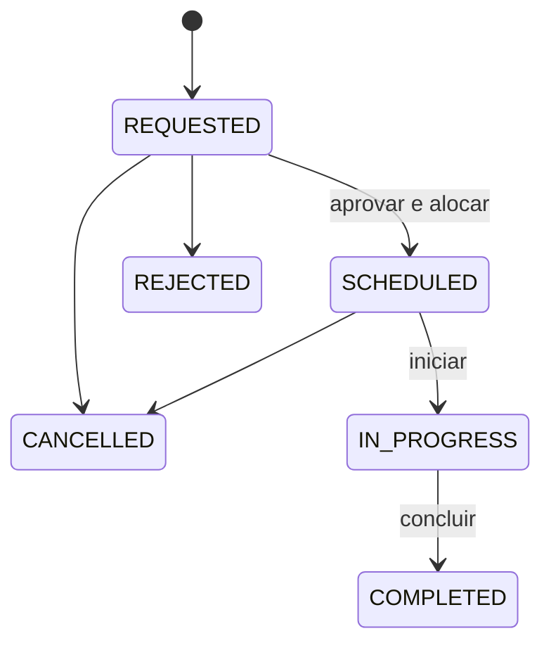

# Arquitetura da frota e proposta de viagens (`Route`)

Este documento registra a análise do código existente e a proposta para a
funcionalidade de viagens. A entidade `Route`, sua API e suas migrations ainda
não estão implementadas.

## 1. Alterações desta documentação

- Atualização do `README.md` principal com o estado atual da frota e as migrations
  de veículos, documentos, motoristas e CNHs.
- Correção da URL local documentada para `http://localhost:8081`, conforme
  `server.port` em `application.properties`.
- Criação deste arquivo com os relacionamentos propostos para viagens, regras de
  negócio, componentes a criar e conflitos encontrados na análise.

Esta atualização modifica documentação. Os componentes Java e as migrations
descritos como existentes já estavam no projeto.

## 2. Organização atual

Os pacotes ficam em `src/main/java/br/com/gestaofrota`:

| Pacote | Responsabilidade |
| --- | --- |
| `domain.models` | Entidades JPA e métodos de alteração de estado. |
| `domain.enums` | Perfis, permissões e estados do domínio. |
| `domain.exceptions` | Erros de validação, conflito, autorização e recurso não encontrado. |
| `infra.repositories` | Persistência com Spring Data JPA, consultas, carregamento de associações e bloqueios. |
| `application.services` | Casos de uso, regras de negócio e transações. |
| `api.v1.controllers` | Endpoints HTTP, validação de entrada e autorização por permissão. |
| `api.v1.dtos` | Records de entrada e saída, separados entre requests e responses. |
| `infra.security` | Autenticação JWT e integração com Spring Security. |

As migrations ficam em `src/main/resources/db/migration`. O Hibernate utiliza
`ddl-auto=validate`: alterações de estrutura precisam de migration. O projeto
também configura `open-in-view=false`, exigindo planejamento do carregamento de
associações utilizadas nos responses.

## 3. Base de frota já existente

| Componente | Comportamento presente no código |
| --- | --- |
| `Vehicle` | Setor opcional, placa, modelo, capacidade, tipo de uso, hodômetro, situação cadastral, versão e datas de auditoria. |
| `Driver` | Vínculo obrigatório e único com `User`, situação cadastral, versão e datas de auditoria. |
| `VehicleDocument` | Histórico de documentos por veículo e tipo, com emissão, validade e estado `ACTIVE` ou `REPLACED`. |
| `DriverLicense` | Histórico de CNHs por motorista, com número, categoria, emissão, validade e estado do registro. |
| Services de frota | Normalização e unicidade de placas, hodômetro sem redução, criação de motoristas para usuários ativos com perfil `MOTORISTA` e substituição de documentos preservando histórico. |
| Repositories | `@EntityGraph` em leituras principais e `lockById` para veículos e motoristas. |
| Controllers e DTOs | Cadastros e consultas de frota, documentos e CNHs, com validação e permissões específicas. |

As migrations `V6` a `V10` criam essa base. As versões anteriores cuidam de
usuários, setores, revogação de tokens e matriz de permissões.

`User` pertence obrigatoriamente a um setor. O setor de um motorista é alcançado
por `Driver.user.sector`. A criação de um usuário com perfil `MOTORISTA` não cria
automaticamente o registro `Driver`.

## 4. Modelagem proposta para `Route`

Uma `Route` representa uma viagem individual desde a solicitação até o término,
com um solicitante, um veículo e um motorista. Nesta proposta, aprovação e
alocação dos recursos acontecem juntas no agendamento.

| Campo | Relacionamento | Regra |
| --- | --- | --- |
| `vehicle` | Muitos `Route` para um `Vehicle` | Opcional na solicitação e obrigatório a partir do agendamento. |
| `driver` | Muitos `Route` para um `Driver` | Opcional na solicitação e obrigatório a partir do agendamento. |
| `requestedBy` | Muitos `Route` para um `User` | Obrigatório; identificado pela autenticação. |
| `requestedSector` | Muitos `Route` para um `Sector` | Obrigatório; fixado na criação da solicitação. |
| `approvedBy` | Muitos `Route` para um `User` | Preenchido pelo servidor ao aprovar e agendar. |

Os vínculos devem usar `@ManyToOne(fetch = FetchType.LAZY)`. `driver_id` referencia
`drivers.id`, enquanto o usuário autenticado é identificado por `users.id`.
Esses identificadores não são intercambiáveis.

O setor solicitante deve ser independente do setor do veículo e do motorista.
Persistir seu vínculo na viagem preserva a associação mesmo quando o solicitante
é transferido para outro setor. Caso seja necessário preservar também o nome
exato do setor à época, será preciso definir uma estratégia adicional de histórico.

Inicialmente, os vínculos podem ser unidirecionais em `Route`. O histórico pode
ser consultado pelo repository, sem coleções de viagens nas entidades atuais.
As referências não devem propagar remoção para veículos, motoristas ou usuários.

### Campos adicionais

| Grupo | Campos sugeridos |
| --- | --- |
| Identidade e concorrência | `UUID id`, `long version` com `@Version`. |
| Finalidade | `origin`, `destination`, `purpose`, `notes`. |
| Planejamento | `Instant plannedDepartureAt`, `plannedReturnAt`. |
| Execução | `Instant startedAt`, `finishedAt`. |
| Quilometragem | `Long startOdometerKm`, `endOdometerKm`, ausentes antes da execução. |
| Controle e auditoria | `RouteStatus status`, `approvedAt`, motivo de rejeição ou cancelamento, `createdAt`, `updatedAt`. |

A distância percorrida pode ser calculada pela diferença entre os hodômetros.

### Estados e transições

Veículo e motorista são obrigatórios em `SCHEDULED`, `IN_PROGRESS` e `COMPLETED`.
As transições devem ser métodos do domínio coordenados pelo service. Uma viagem
concluída deve preservar seus dados de execução.

## 5. Regras propostas

1. Validar a ordem dos horários previstos e dos horários de execução.
2. Validar veículo e motorista ativos, usuário do motorista ativo e perfil
   `MOTORISTA` ao alocar e iniciar a viagem.
3. Verificar CNH e documentos exigidos, considerando emissão e validade no
   período previsto; revalidar os documentos no início.
4. Impedir sobreposição de viagens agendadas ou em execução para o mesmo recurso.
   Dois intervalos se sobrepõem quando `inicioExistente < novoFim` e
   `fimExistente > novoInicio`. Intervalos consecutivos são permitidos.
5. Bloquear veículo e motorista antes da consulta de conflitos e do agendamento,
   dentro da mesma transação e com ordem consistente de bloqueios.
6. No início, verificar também ocupação real: uma viagem que ultrapassou o retorno
   previsto continua ocupando seus recursos enquanto estiver em execução.
7. Impedir redução do hodômetro e registrar conclusão e quilometragem do veículo
   atomicamente. Definir o tratamento de ajustes administrativos durante a viagem.
8. Validar permissão e vínculo com cada viagem: solicitante acessa suas demandas,
   motorista acessa e executa suas viagens e gestor administra o escopo autorizado.
9. Preservar histórico ao desativar recursos e impedir exclusão de setores que
   ainda estejam referenciados por viagens.

## 6. Componentes a criar

Todos os itens desta seção são propostas para uma implementação futura.

| Componente | Responsabilidade proposta |
| --- | --- |
| `domain.models.Route` | Dados da viagem, versão, relacionamentos e transições válidas. |
| `domain.enums.RouteStatus` | Estados do ciclo de vida da viagem. |
| `infra.repositories.RouteRepository` | Filtros paginados, consultas de agenda, controle do escopo de leitura e bloqueio para transições. |
| `application.services.RouteService` | Solicitar, agendar, iniciar, concluir, cancelar e rejeitar viagens. |
| `api.v1.controllers.RouteController` | API em `/api/v1/routes`, com operações explícitas por transição. |
| DTOs de request | `CreateRouteRequest`, `ScheduleRouteRequest`, `StartRouteRequest`, `CompleteRouteRequest` e dados de cancelamento ou rejeição. |
| DTO de response | `RouteResponse` com identificadores, resumos dos recursos, estado, horários e quilometragem. |

Exemplos de endpoints propostos: `POST /api/v1/routes`, `GET /api/v1/routes` e
`POST /api/v1/routes/{id}/schedule`, `/start`, `/complete`, `/cancel` e `/reject`.

O solicitante e o aprovador devem vir da autenticação. Os responses precisam de
carregamento planejado por `@EntityGraph`, projeções ou conversão dentro da
transação, sem serializar entidades relacionadas diretamente.

### Permissões e migrations propostas

Acrescentar `ROUTES_READ`, `ROUTES_REQUEST`, `ROUTES_MANAGE` e `ROUTES_EXECUTE`
ao enum `Permission` e à restrição SQL de permissões. A concessão inicial deve
respeitar a matriz configurada para cada perfil e as regras de acesso por viagem.

Considerando que a versão atual termina em `V10`, a sugestão é:

- `V11__create_routes.sql`: tabela, chaves estrangeiras, índices e restrições de
  estado, horários, hodômetros e campos obrigatórios por estado.
- `V12__add_route_permissions.sql`: ampliação da restrição SQL e concessão das
  permissões de viagens conforme a política definida.

As versões precisam ser verificadas antes da implementação. Migrations já
aplicadas devem ser preservadas. Índices únicos parciais podem reforçar a regra
de uma única viagem `IN_PROGRESS` por veículo e por motorista; a agenda futura
também exige a verificação transacional de intervalos.

## 7. Conflitos identificados no código atual

| Ponto | Impacto e encaminhamento |
| --- | --- |
| `VehicleStatus` e `DriverStatus` sem persistência | Não representam disponibilidade efetiva. `AVAIBLE` e `UNAVAIBLE` também precisam de correção de grafia antes de consolidar um contrato. |
| `UpdateVehicleStatus` sem operação associada | A presença do DTO não significa que exista atualização de situação operacional. |
| `is_active` e ocupação | Separar situação cadastral de ocupação. `IN_ROUTE` pode ser derivado das viagens em execução; disponibilidade futura depende do período. |
| `@Version` em veículo e motorista | Inserir viagens sem alterar os recursos não impede duas reservas concorrentes; coordenar bloqueios e consultas. |
| Desativações e mudanças de perfil | Os services atuais não consultam viagens. Impedir inconsistências ou exigir remanejamento antes da alteração. |
| Atualização cadastral do hodômetro | `VehicleService.update` já altera a quilometragem; coordenar essa operação com início e conclusão de viagens. |
| Documento `ACTIVE` vencido | `ACTIVE` identifica a versão atual do registro. Verificar datas para determinar sua validade na viagem. |
| Categoria da CNH e tipo de veículo | Os textos atuais não estabelecem uma regra suficiente de compatibilidade; definir os dados e a política necessários. |
| Filtros em `DriverController` | `find/{status}`, `find/{role}` e `find/{sector}` têm o mesmo formato de URL. Há também divergência entre `{status}` e o parâmetro `active`. Preferir filtros por query parameters e UUID de setor. |
| Retorno de `List<Driver>` nos filtros | Pode causar falhas de carregamento ou exposição de dados internos de `User`, inclusive o hash da senha se serializado. Utilizar DTOs. |
| Exclusão de setor | `SectorService.delete` verifica usuários e veículos; deverá verificar viagens ao introduzir `requestedSector`. |
| Tratamento de concorrência | O handler atual cobre conflitos de integridade, mas não trata explicitamente falhas de bloqueio otimista; definir respostas adequadas para operações concorrentes. |

## 8. Decisões de negócio pendentes

- Aprovação e alocação juntas ou aprovação em uma etapa anterior ao agendamento.
- Escopo de atuação dos gestores por setor e critérios de cancelamento.
- Documentos obrigatórios e regra de compatibilidade da CNH com o veículo.
- Significado da capacidade do veículo e eventual controle de passageiros.
- Representação de manutenção e outros bloqueios operacionais.
- Fuso de negócio e fonte de horário para validar documentos e execução.
- Necessidade de agrupar solicitações ou trocar motorista e veículo na mesma viagem.

## 9. Validação prevista

A base atual possui testes de integração com PostgreSQL/Testcontainers em
`FleetFoundationIntegrationTests` e testes de autorização em
`FleetControllerAuthorizationTests`.

A implementação de viagens deve cobrir persistência e migrations, transições
inválidas, agendamento concorrente, viagens consecutivas, atraso no retorno,
documentos vencidos, desativação de recursos comprometidos, atualização atômica
do hodômetro e acesso a viagens de outro usuário.

Nesta atualização de documentação, não foram executados build, testes ou
migrations. Os comportamentos e conflitos descritos resultam de análise estática.
